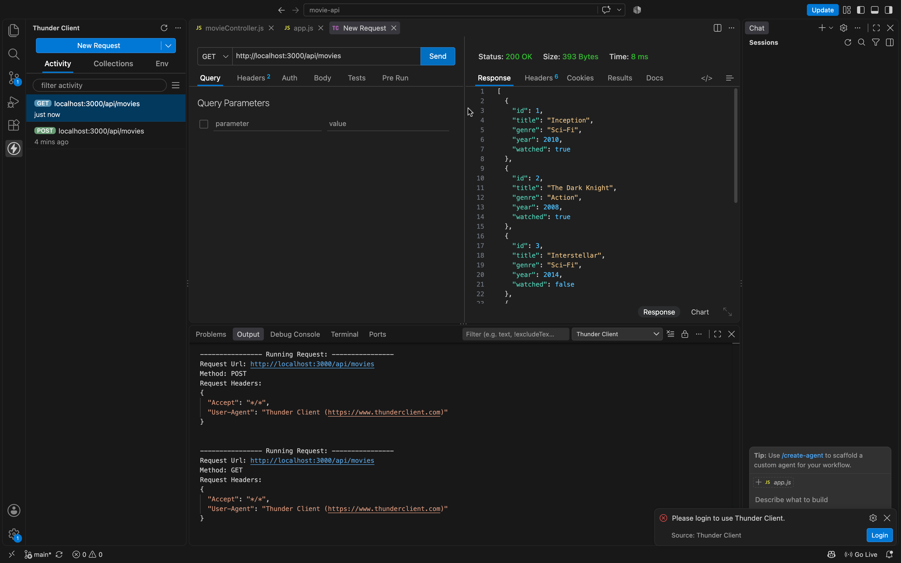
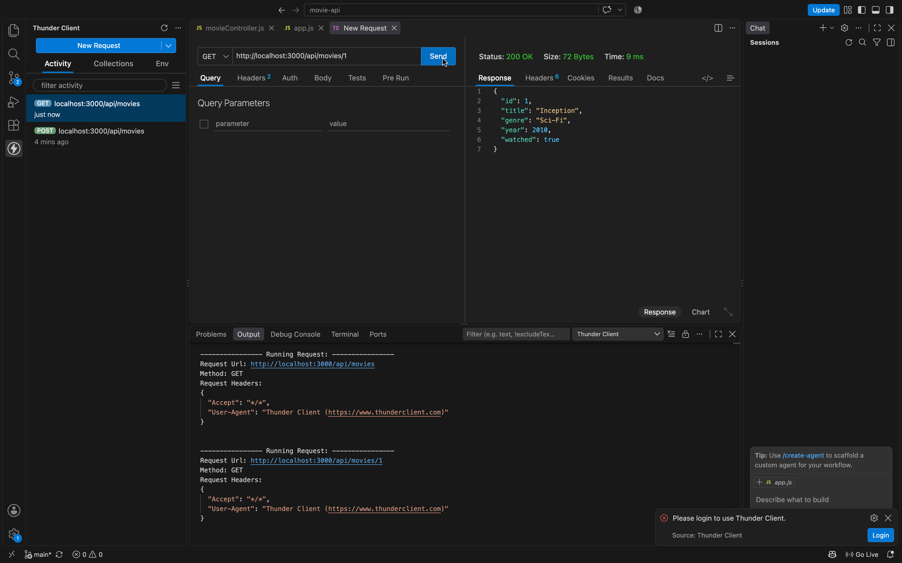
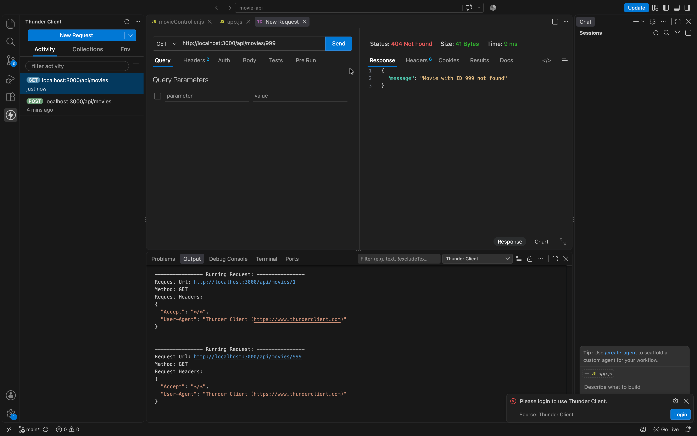
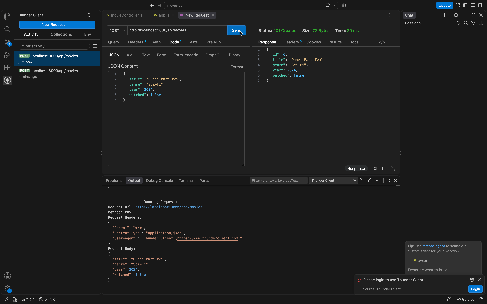
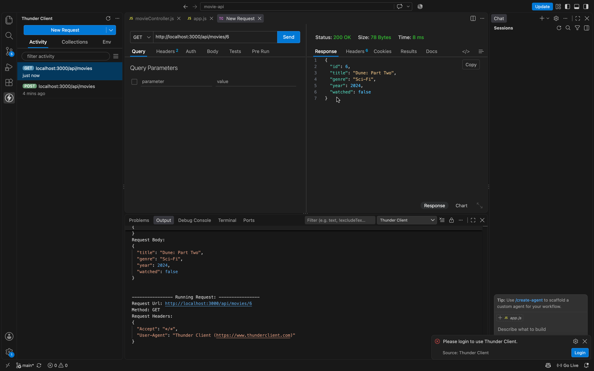
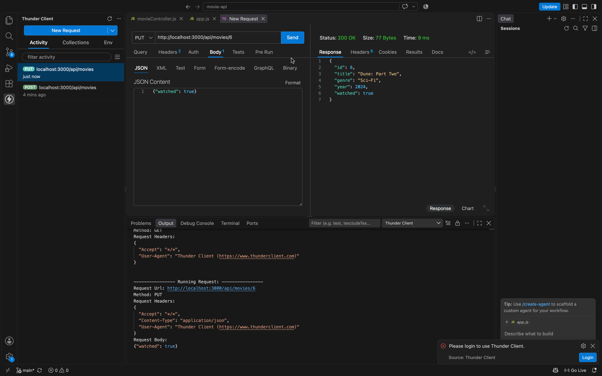
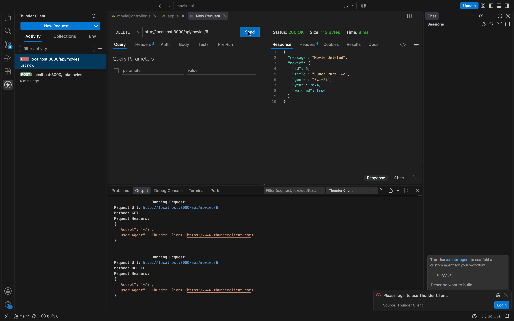
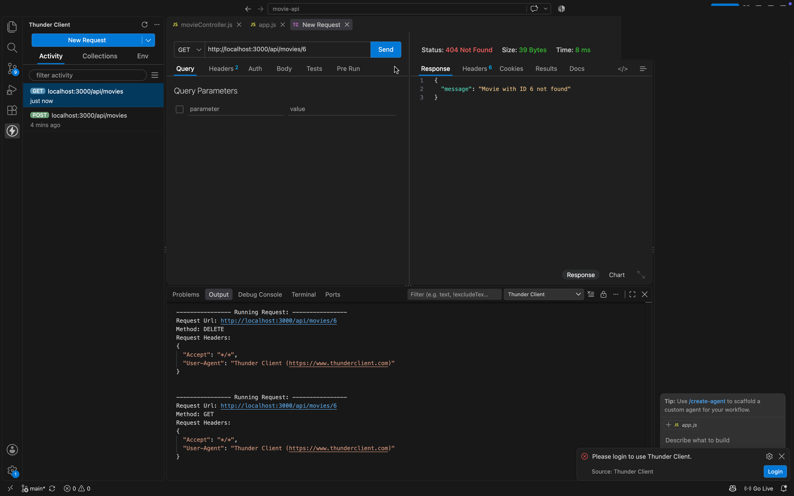
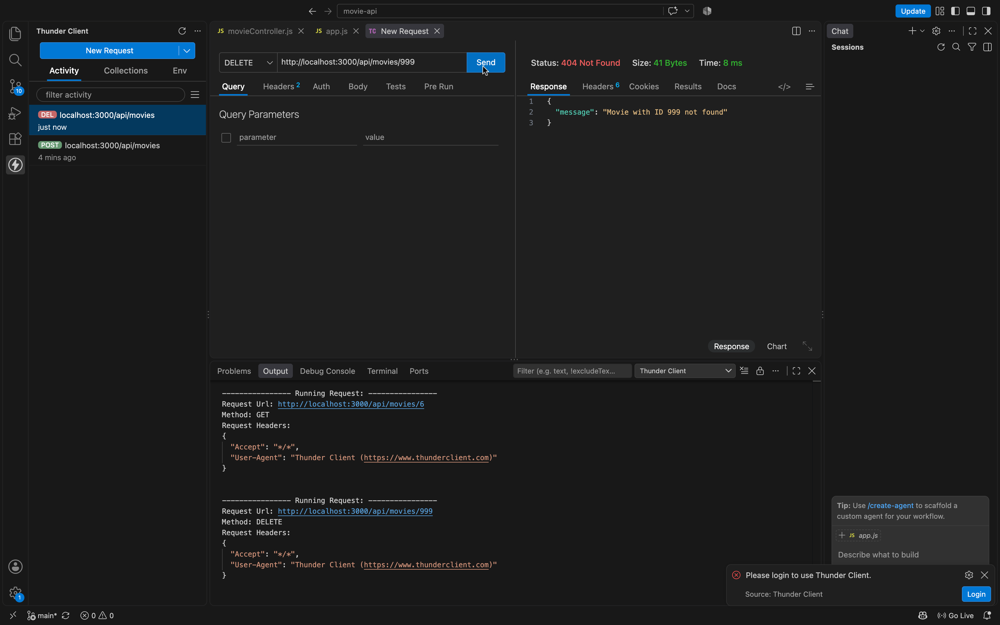

# Movie Watchlist API

A RESTful backend API for a movie watchlist, built with Node.js and Express. Users can add, view, update and remove movies.

There is no database. Movies are stored in an array in memory, so the data resets every time the server restarts.

**Request flow:** Client → Route → Controller → Data → Response

## Technologies Used

- Node.js
- Express.js
- Thunder Client (API testing)

## Project Structure

```
movie-api/
├── controllers/
│   └── movieController.js   # CRUD logic, validation and responses
├── routes/
│   └── movieRoutes.js       # Connects HTTP methods + endpoints to controllers
├── data/
│   └── movies.js            # Array with 5 starter movies
├── screenshots/             # API testing evidence
├── app.js                   # Main application file (server setup)
├── package.json
└── package-lock.json
```

## Installation

1. Make sure [Node.js](https://nodejs.org) is installed.
2. Clone the repository:
```bash
   git clone https://github.com/Andre-vdm-dev/movie-api.git
   cd movie-api
```
3. Install dependencies:
```bash
   npm install
```

## Starting the Server

```bash
npm start
```

Or, to restart automatically when files change:

```bash
npm run dev
```

The server runs at **http://localhost:3000**.

## Movie Data

| Field   | Type    | Description                        |
| ------- | ------- | ---------------------------------- |
| id      | number  | Unique identifier (auto-generated) |
| title   | string  | Name of the movie                  |
| genre   | string  | Movie genre                        |
| year    | number  | Release year                       |
| watched | boolean | Whether the movie has been watched |

## Available Endpoints

| Functionality  | Method | Endpoint          | Success | Errors   |
| -------------- | ------ | ----------------- | ------- | -------- |
| Get all movies | GET    | `/api/movies`     | 200     | –        |
| Get one movie  | GET    | `/api/movies/:id` | 200     | 400, 404 |
| Create movie   | POST   | `/api/movies`     | 201     | 400      |
| Update movie   | PUT    | `/api/movies/:id` | 200     | 400, 404 |
| Delete movie   | DELETE | `/api/movies/:id` | 200     | 400, 404 |

### Example POST body

```json
{
  "title": "Dune: Part Two",
  "genre": "Sci-Fi",
  "year": 2024,
  "watched": false
}
```

For **PUT**, only send the fields you want to change, for example:

```json
{ "watched": true }
```

## Error Handling

| Situation                                | Status | Response message                    |
| ---------------------------------------- | ------ | ----------------------------------- |
| Movie ID does not exist                  | 404    | `Movie with ID 999 not found`       |
| Invalid ID (e.g. `/api/movies/abc`)      | 400    | `Invalid movie ID...`               |
| Missing or invalid fields on POST / PUT  | 400    | `Invalid movie data` + error list   |
| Empty PUT body                           | 400    | `Send at least one field to update` |
| Broken JSON in the request body          | 400    | `Request body must be valid JSON`   |
| Route does not exist                     | 404    | `Route GET /api/... not found`      |

## How to Test the API

1. Start the server with `npm run dev`.
2. Open Thunder Client (or Postman / Insomnia).
3. For POST and PUT, choose **Body → JSON** and paste the JSON.
4. Run the tests in this order (don't save files in between, because that restarts the server and resets the data):

| #  | Test                                 | Request                                  | Expected |
| -- | ------------------------------------ | ---------------------------------------- | -------- |
| 1  | Retrieve all movies                  | `GET /api/movies`                        | 200      |
| 2  | Retrieve one existing movie          | `GET /api/movies/1`                      | 200      |
| 3  | Retrieve a movie that doesn't exist  | `GET /api/movies/999`                    | 404      |
| 4  | Create a new movie                   | `POST /api/movies`                       | 201      |
| 5  | Retrieve the new movie               | `GET /api/movies/6`                      | 200      |
| 6  | Update an existing movie             | `PUT /api/movies/6` `{ "watched": true }`| 200      |
| 7  | Retrieve the updated movie           | `GET /api/movies/6`                      | 200      |
| 8  | Delete a movie                       | `DELETE /api/movies/6`                   | 200      |
| 9  | Retrieve the deleted movie           | `GET /api/movies/6`                      | 404      |
| 10 | Delete a movie that doesn't exist    | `DELETE /api/movies/999`                 | 404      |

## Testing Evidence

| Test | Screenshot |
| ---- | ---------- |
| 1. GET all movies |  |
| 2. GET one movie |  |
| 3. GET movie not found (404) |  |
| 4. POST create movie |  |
| 5. GET new movie |  |
| 6. PUT update movie |  |
| 7. GET updated movie |  |
| 8. DELETE movie |  |
| 9. GET deleted movie (404) |  |
| 10. DELETE movie not found (404) |  |

## Author

Andre van der Merwe, 